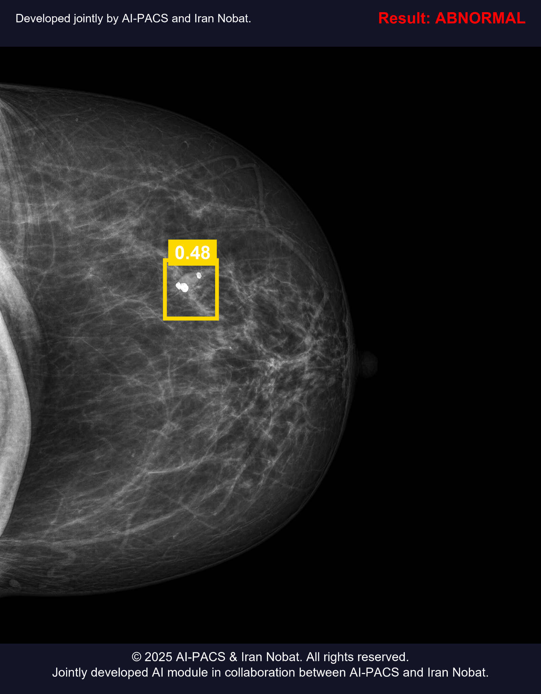
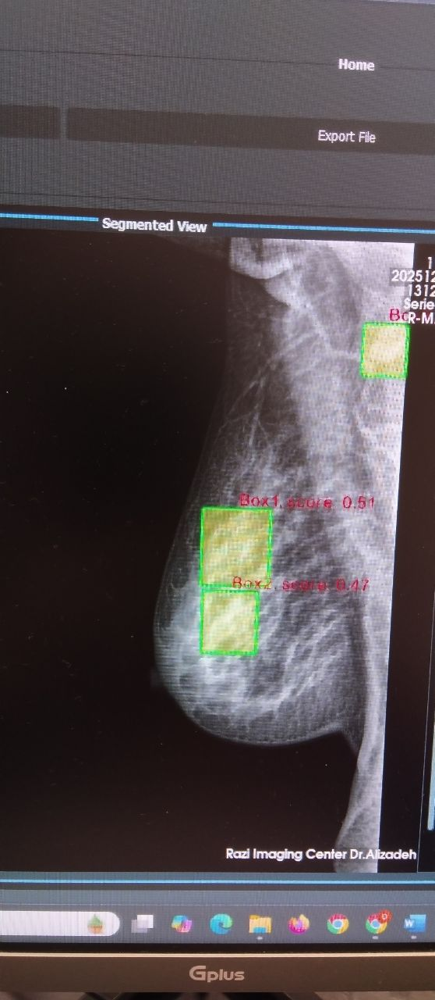
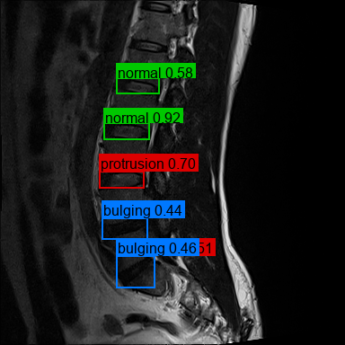
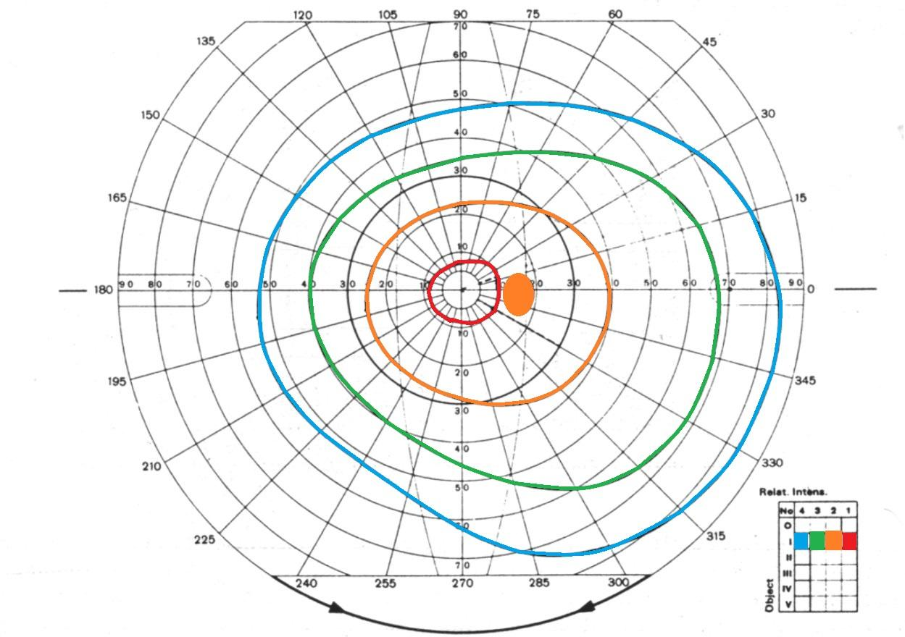
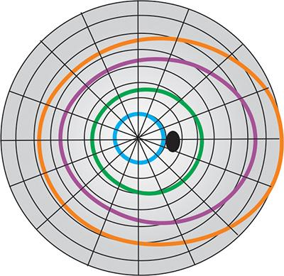

# Hi, I'm Aisan Rahimi 👋
### AI Engineer | Computer Vision Expert | Medical Imaging Specialist

🏢 Founder of [Apadana AI Research Center](https://github.com/Apadana-AI-Research-Center)  
📍 Tehran, Iran  
📧 a.rahimi141923@gmail.com  

---

## 🧠 About Me

AI Engineer and Computer Vision Expert with **5+ years of experience** in medical
imaging, petroleum data analysis, and AI software development. MSc in Photogrammetry
and Image Processing from K.N. Toosi University of Technology.

I build end-to-end AI pipelines for real-world clinical and industrial applications —
from research and model training to deployment and software integration.

---

# 🎯 Expertise

# 🏥 Medical AI Projects:

## 🏥 1-Featured Clinical AI Project | Intelligent Mammography Lesion Detection & BI-RADS-Guided Classification

**Clinical Collaboration:** Razi Radiology Center — Dr. Vahid Alizadeh  
**Joint Development:** AI-PACS & Iran Nobat | 2025  
**Research Status:** Scientific Manuscript in Preparation for Journal Submission

### 🔬 Project Overview

Developed and clinically demonstrated an **end-to-end Artificial Intelligence system for automated mammography analysis**, in collaboration with **Dr. Vahid Alizadeh at Razi Radiology Center**.

The project focuses on the **early identification of suspicious breast abnormalities**, particularly subtle lesions that may be challenging to detect during conventional radiological interpretation.

The system combines intelligent image analysis, suspicious lesion localization, and **BI-RADS-guided multi-label classification**, providing radiologists with visual indications of potentially abnormal regions and associated prediction confidence scores.

Unlike conventional systems limited to normal-versus-abnormal classification, this solution recognizes multiple types of mammographic findings, including:

- **Breast Masses**
- **Suspicious Calcifications**
- **Focal Asymmetries**
- **Normal Mammographic Findings (No Finding)**

The primary objective is to provide an additional layer of intelligent screening support, helping radiologists review challenging mammographic findings while maintaining clinical oversight.

### 🏥 Clinical Demonstration — Razi Radiology Center

The following examples illustrate AI-generated abnormality detection and localization of suspicious breast regions.

  
  

  
  

  <em>Clinical demonstration of AI-assisted mammographic lesion detection, visual localization, and confidence-based predictions.</em>

### 📊 Research Results & Diagnostic Performance

The developed system demonstrated **high performance in experimental mammography screening and abnormality identification**.

#### 🎯 Abnormality Detection Performance

| Performance Metric | Research Result |
|---|---:|
| **Detection Accuracy** | **99.1%** |
| **Detection Precision (PPV)** | **97.8%** |
| **Sensitivity (Recall)** | **100.0%** |
| **Specificity** | **98.6%** |
| **F1-Score** | **98.9%** |

These results reflect image-level normal/abnormal classification performance on the reported independent research test set, highlighting the system's potential for sensitive mammographic screening support.

#### 🩺 Mammographic Finding Classification

In addition to identifying abnormal images, the system was evaluated for its ability to distinguish different mammographic findings using BI-RADS-guided classification.

| Finding Category | Sensitivity | Specificity |
|---|---:|---:|
| **Breast Mass** | **87.3%** | **98.9%** |
| **Suspicious Calcification** | **82.4%** | **99.6%** |
| **Focal Asymmetry** | **71.4%** | **97.8%** |
| **No Finding** | **100.0%** | **84.1%** |

**Overall Multi-Label Classification Results:**

- **Micro F1-Score: 98.1%**
- **Macro F1-Score: 85.8%**
- **Mass Classification F1: 87%**
- **Suspicious Calcification F1: 82%**
- **Focal Asymmetry F1: 73%**

The results demonstrate the system's ability to support the identification and differentiation of multiple mammographic findings rather than providing only binary screening predictions.

**Selected Classification Precision:**

- **Mass:** 84.1%
- **Suspicious Calcification:** 93.3%
- **Focal Asymmetry:** 45.5%
- **No Finding:** 97.3%

These findings highlight strong performance for mass and suspicious calcification classification, while focal asymmetry remains a more challenging category requiring further improvement.

### 🔍 Detection of Subtle Breast Abnormalities

A central focus of this research was the identification of suspicious regions that may be difficult to recognize through routine visual examination.

The AI system was designed to assist with:

- Recognition of small or subtle mammographic abnormalities.
- Localization of candidate suspicious breast lesions.
- Identification of potentially concerning masses and calcification patterns.
- Classification of focal asymmetries and other evaluated mammographic findings.
- Highlighting regions that may require additional radiologist attention.

The ability to combine abnormality detection with finding classification makes the system a promising tool for **AI-assisted breast screening and clinical decision support**.

### 🖥️ Clinical Software Implementation

The developed AI system was demonstrated within a clinical medical imaging environment, with capabilities including:

- Automated mammography image analysis.
- Suspicious region identification.
- Lesion localization and bounding-box visualization.
- Confidence-based prediction display.
- Classification of mammographic findings.
- Radiologist-assisted clinical review.

  

  <em>AI-powered mammography analysis demonstrated in a clinical imaging workflow at Razi Radiology Center.</em>

### 🎯 Clinical Significance

This project represents a practical application of **Artificial Intelligence in Breast Imaging and Radiology**, combining advanced medical image analysis with real-world clinical collaboration.

**Key Achievements:**

- Developed an end-to-end AI-assisted mammography analysis workflow.
- Achieved **99.1% image-level abnormality detection accuracy** in the reported research evaluation.
- Demonstrated **97.8% detection precision and 100% sensitivity** under the evaluated test conditions.
- Implemented detection and classification of multiple mammographic findings.
- Achieved **99.6% specificity for suspicious calcification classification**.
- Demonstrated visual candidate lesion localization and interpretable predictions.
- Presented the software workflow in a clinical radiology environment.

The system is designed to **assist radiologists, not replace their professional judgment**. Additional prospective evaluation and reader studies are required to establish improvements in real-world diagnostic outcomes.

### 📄 Research Publication

A scientific manuscript describing the methodology, technical innovations, and detailed experimental evaluation is currently being prepared for submission to a peer-reviewed journal.

**Research methods, model architecture, and unpublished technical details remain confidential pending publication.**

### 🛠️ Expertise Demonstrated

**Medical Artificial Intelligence | Mammography Analysis | Breast Lesion Detection | Medical Computer Vision | BI-RADS-Guided Classification | Clinical Decision Support | Medical Image Processing | Healthcare AI**

## 2-Evaluation & Fine-Tuning of Vision-Language Models for Medical Image Understanding

Conducted experimental research on medical Vision-Language Models (VLMs) and Large Language Models (LLMs), focusing on multimodal medical image understanding, anatomical localization, disease interpretation, and automated radiology report generation. Evaluated and experimented with models including MedGemma, Gemma-based architectures, and PaliGemma-related object detection approaches, using brain imaging and chest CT datasets. Explored domain-specific fine-tuning strategies involving LoRA/PEFT, vision encoder adaptation, quantization, and image-text instruction tuning to improve medical image interpretation and structured clinical reporting. Investigated the ability of multimodal models to recognize abnormalities, identify anatomical regions, estimate spatial positions, and associate findings with their correct locations. Experiments revealed significant limitations in precise anatomical localization, spatial reasoning, and position-aware reporting, highlighting the challenges of applying general-purpose VLMs to detailed medical imaging tasks. This research provided hands-on experience in multimodal model evaluation, medical dataset preparation, fine-tuning, prompt engineering, and failure analysis, supporting the development of more reliable hybrid workflows combining specialized computer vision models with medical LLMs.

Technologies: Python | PyTorch | Hugging Face Transformers | MedGemma | PaliGemma | Vision-Language Models | LoRA/PEFT | Quantization | Medical Image Analysis | Multimodal Fine-Tuning

## 3-Automated Lumbar Disc Disease Detection, Classification & AI-Assisted Radiology Reporting

Developed an end-to-end deep learning pipeline for automated lumbar spine MRI analysis, integrating intervertebral disc localization, segmentation, and pathology classification using Vision Transformers (ViT), object detection, and multi-task deep learning architectures. The system analyzes sagittal and axial MRI images to identify lumbar disc levels (L1–L2 through L5–S1) and classify disc conditions into four categories: Normal, Bulging, Protrusion, and Extrusion, providing confidence scores and visual bounding-box annotations. The project incorporated DICOM–NIfTI image-mask alignment, class-imbalance optimization, and multi-task segmentation and classification. Additionally, MedGemma integration was explored to transform structured imaging findings into AI-generated radiology-style reports, supporting automated medical image interpretation and clinical decision-support workflows.
Technologies: Python | PyTorch | Vision Transformers (ViT-B/16) | Object Detection | Medical Image Segmentation | DICOM | NIfTI | SimpleITK | MedGemma

<h4>Project Results — Lumbar Disc Disease Detection</h4>

  
  
  

  <em>AI-based lumbar disc detection and classification
  on sagittal and axial MRI images, with predicted
  pathology labels, bounding boxes, and confidence scores.</em>

## 4-Automated Lumbar Vertebrae Segmentation & Classification Using Deep Learning

Developed an AI-powered lumbar spine MRI analysis system using a customized U-Net deep learning architecture for automated vertebral segmentation, identification, and anatomical classification. The model processes 2D sagittal MRI images and incorporates specialized strategies to address class imbalance and improve segmentation performance. An integrated classification head was designed to identify individual lumbar vertebrae and assign their corresponding anatomical levels (L1–L5). The system generates individual color-coded segmentation masks with anatomical labels, enabling automated vertebral localization and identification. This project demonstrates the application of Deep Learning, Medical Image Segmentation, Computer Vision, and Anatomical Structure Recognition to support quantitative spinal imaging analysis.

<h4>Automated Lumbar Spine MRI Analysis — Project Results</h4>

  
  

  <em>Original sagittal lumbar MRI (left) and
  AI-generated color-coded vertebral segmentation (right).</em>

Technologies: Deep Learning | Customized U-Net | Medical Image Processing | Semantic Segmentation | Multi-Class Classification | Lumbar Spine MRI
-AI-Assisted Goldmann Visual Field Analysis & Measurement Automation

Collaborated with an ophthalmology specialist on an AI-based medical image analysis project focused on Goldmann visual field perimetry. The project aimed to automate the interpretation and quantitative measurement of ophthalmic diagnostic charts using Computer Vision, Image Processing, and Artificial Intelligence. The proposed solution focused on identifying coordinate systems, detecting colored isopters and visual field boundaries, extracting geometric features, and supporting automated measurements of visual field extent and irregularities. The objective was to reduce time-consuming manual measurements, improve analytical consistency, and support ophthalmologists in clinical assessment through AI-assisted image analysis.

<h4>Goldmann Visual Field Analysis — Project Images</h4>

  
  

  <em>Original visual field chart (left) and
  AI-assisted analysis (right).</em>

- Mammography AI pipeline — BI-RADS classification, 85–98% precision
- Spine MRI segmentation — 85% Dice/IoU
- Bone age estimation from MRI — ~3 month mean error (ages 7–14)
- Ophthalmology AI — retinopathy detection & fundus analysis
- 3D medical depth estimation (Depth Anything V2, DPT)
- Vision-Language Model evaluation (MedGEMMA, CLIP, BLIP)

### 🛢️ Petroleum AI
- MFL pipeline defect detection (YOLO, UNet, FCOS)

- Well log conversion: LAS/DLIS → SEG-Y
- AI-assisted fracture & corrosion detection

### 👁️ Computer Vision
- Object detection & segmentation (YOLO v3/v5/v8, UNet, RetinaNet, FCOS)
- Medical image processing (ITK, VTK, SimpleITK, MONAI)
- Cross-platform AI software (C++/Qt, C#, Python)

---

## 🛠️ Tech Stack

**Frameworks:** PyTorch · TensorFlow · ONNX · Scikit-learn · XGBoost  
**Vision:** YOLO · UNet · RetinaNet · FCOS · EfficientNet · SAM  
**Medical:** ITK · VTK · MONAI · pydicom · SimpleITK  
**Software:** Qt/C++ · C# WPF · Python APIs · DICOM/PACS integration  

---

## 🏛️ My Company

**[Apadana AI Research Center](https://github.com/Apadana-AI-Research-Center)**  
Independent AI research & development — Medical Imaging | Petroleum AI | Computer Vision

---

## 📚 Education

🎓 **MSc** — Photogrammetry & Image Processing, K.N. Toosi University (KNTU), 2006  
🎓 **BSc** — Surveying Engineering, K.N. Toosi University (KNTU), 2002  

---

*Open to research collaboration and AI development partnerships.*
