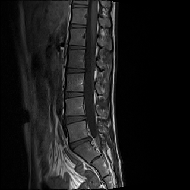

# Hi, I'm Aisan Rahimi 👋
### AI Engineer | Computer Vision Expert | Medical Imaging Specialist

🏢 Founder of [Apadana AI Research Center](https://github.com/Apadana-AI-Research-Center)  
📍 Tehran, Iran  
📧 a.rahimi141923@gmail.com  

---

## 🧠 About Me

AI Engineer and Computer Vision Expert with **5+ years of experience** in medical
imaging, petroleum data analysis, and AI software development. MSc in Photogrammetry
and Image Processing from K.N. Toosi University of Technology.

I build end-to-end AI pipelines for real-world clinical and industrial applications —
from research and model training to deployment and software integration.

---

## 🎯 Expertise

### 🏥 Medical AI

## 🏥 Featured Clinical AI Project | Automated Mammography Lesion Detection & BI-RADS-Guided Classification

**Clinical Collaboration:** Razi Radiology Center — Dr. Vahid Alizadeh  
**Joint Development:** AI-PACS & Iran Nobat | 2025  
**Research Status:** Manuscript in preparation for journal submission

### 🔬 Project Overview

Developed and clinically demonstrated an **end-to-end AI-assisted mammography analysis system** in collaboration with **Dr. Vahid Alizadeh at Razi Radiology Center**.

The project focuses on **detecting subtle and potentially overlooked breast abnormalities**, including small masses, suspicious calcifications, and focal asymmetries that can be challenging for radiologists to identify during conventional visual examination.

The system integrates **deep learning-based lesion detection, candidate localization, multi-view mammographic analysis, and BI-RADS-guided multi-label classification**.

Unlike conventional binary cancer detection systems, this framework identifies and characterizes multiple mammographic findings:

- **Mass**
- **Suspicious Calcification**
- **Focal Asymmetry**
- **No Finding**

The AI analyzes different mammographic projections (CC and MLO), identifies suspicious regions, generates visual bounding boxes and confidence scores, and produces interpretable classification results to assist radiological assessment.

### 🏥 Clinical Demonstration — Razi Radiology Center

The following images demonstrate AI-generated abnormality detection and candidate lesion localization.

  
  

  
  

  <em>AI-assisted mammographic abnormality detection showing suspicious regions, bounding boxes, and model confidence scores.</em>

### ⚙️ Technical Architecture

A modular three-stage AI framework was developed to support lesion detection, quantitative characterization, and classification.

**Stage 1 — Hybrid FCOS Lesion Detection**

A customized FCOS detector incorporating a ResNet-50 backbone, Feature Pyramid Network (FPN), and auxiliary global classification head performs image-level abnormality detection and lesion localization.

**Stage 2 — BI-RADS-Guided Feature Extraction**

Detected regions are characterized through radiologically meaningful features:

- Lesion shape, density, margins, and texture
- Calcification distribution and clustering
- CC/MLO cross-view consistency
- Left-right breast asymmetry analysis

**Stage 3 — Multi-Label XGBoost Classification**

A stacked XGBoost ensemble performs finding classification using class-specific feature combinations, probability calibration, and clinically constrained threshold optimization.

**Complete AI Processing Pipeline**

  

**Hybrid FCOS Architecture**

  

### 📊 Experimental Evaluation & Performance

The system was evaluated using the **RSNA Screening Mammography dataset**, comprising **20,486 mammographic images**.

| Dataset Split | Images |
|---|---:|
| Training | 16,391 |
| Validation | 3,745 |
| Independent Detection Test | 350 |
| **Total** | **20,486** |

#### 1. Abnormality Detection Performance

The Hybrid FCOS detection system achieved the following image-level results on the independent test set:

| Evaluation Metric | Result |
|---|---:|
| **Accuracy** | **99.1%** |
| **Precision (PPV)** | **97.8%** |
| **Sensitivity (Recall)** | **100.0%** |
| **Specificity** | **98.6%** |
| **F1-Score** | **98.9%** |

These results demonstrate strong abnormality-screening performance under the reported test conditions, with high sensitivity for identifying images requiring further assessment.

#### 2. Lesion Localization Performance

Localization was evaluated using Intersection over Union (IoU):

| Localization Metric | Result |
|---|---:|
| Detection Rate (IoU > 0) | 86.8% |
| Detection Rate (IoU ≥ 0.3) | 60.3% |
| Detection Rate (IoU ≥ 0.5) | 47.1% |
| Mean IoU | 0.443 |

The detection framework prioritizes the identification of candidate suspicious regions rather than exact lesion boundary delineation.

**Lesion Localization Analysis**

  

#### 3. BI-RADS-Guided Multi-Label Classification

The optimized multi-view XGBoost classifier achieved:

| Mammographic Finding | Sensitivity | Specificity | Precision |
|---|---:|---:|---:|
| **Mass** | **87.3%** | 98.9% | 84.1% |
| **Suspicious Calcification** | 82.4% | **99.6%** | **93.3%** |
| **Focal Asymmetry** | 71.4% | 97.8% | 45.5% |
| **No Finding** | **100.0%** | 84.1% | 97.3% |

**Overall Multi-Label Classification Results**

- **Micro F1-Score:** 98.1%
- **Macro F1-Score:** 85.8%
- **Mass F1-Score:** 87%
- **Suspicious Calcification F1-Score:** 82%
- **Focal Asymmetry F1-Score:** 73%

**Classification Performance Analysis**

  

#### 4. Multi-View Analysis & Performance Improvement

The research compared four feature configurations to evaluate the contribution of cross-view and bilateral information.

| Feature Configuration | Test Macro F1 |
|---|---:|
| Single-View | 74.5% |
| **Multi-View (CC/MLO)** | **85.8%** |
| Bilateral | 73.8% |
| Combined | 84.1% |

Multi-view feature integration substantially improved classification performance.

The most notable improvement occurred in **Focal Asymmetry detection**, where the F1-score increased from **42% to 73%**, corresponding to approximately **74% relative improvement** over single-view analysis.

This finding highlights the importance of cross-view comparison when analyzing subtle mammographic abnormalities.

**Multi-View Performance Comparison**

  

### 🖥️ Clinical Software Integration

The AI workflow was demonstrated within a medical imaging interface supporting:

- Mammographic image visualization
- Automatic abnormality detection
- Visual localization of suspicious regions
- Confidence score visualization
- BI-RADS-guided finding classification
- Radiologist-assisted image review

**Clinical Software Interface**

  

**Clinical Demonstration at Razi Radiology Center**

  

### 🎯 Clinical Significance & Research Contribution

The primary objective of this project is to enhance mammographic screening by assisting radiologists in identifying subtle suspicious abnormalities that might otherwise require additional detailed examination.

**Key Contributions:**

- Development of an end-to-end AI-assisted mammography analysis workflow.
- High image-level abnormality detection precision and sensitivity on the evaluated dataset.
- Visual localization of candidate suspicious lesions.
- Multi-label classification using BI-RADS-aligned finding terminology.
- Improved focal asymmetry recognition through multi-view analysis.
- Interpretable model outputs supporting clinical review.
- Demonstration of the AI workflow at Razi Radiology Center.

The system is designed as a **clinical decision-support tool** rather than an autonomous diagnostic replacement. Further prospective evaluation and radiologist comparison studies are needed to establish real-world clinical effectiveness.

### 📄 Scientific Research & Publication

**Manuscript Title:**  
*Automated Multi-View Mammography Analysis Using BI-RADS-Guided AI for Clinical Decision Support*

**Authors:** Dr. Vahid Alizadeh, Asieh Rahimi, Dr. Bahareh Mobasheri

**Publication Status:** Manuscript in preparation for submission to a peer-reviewed scientific journal.

### 🛠️ Technologies & Methods

**Python | PyTorch | Hybrid FCOS | ResNet-50 | Feature Pyramid Networks | XGBoost | Scikit-learn | DICOM | Medical Image Processing | Object Detection | Multi-Label Classification | Radiomics | BI-RADS Feature Engineering**

-Evaluation & Fine-Tuning of Vision-Language Models for Medical Image Understanding

Conducted experimental research on medical Vision-Language Models (VLMs) and Large Language Models (LLMs), focusing on multimodal medical image understanding, anatomical localization, disease interpretation, and automated radiology report generation. Evaluated and experimented with models including MedGemma, Gemma-based architectures, and PaliGemma-related object detection approaches, using brain imaging and chest CT datasets. Explored domain-specific fine-tuning strategies involving LoRA/PEFT, vision encoder adaptation, quantization, and image-text instruction tuning to improve medical image interpretation and structured clinical reporting. Investigated the ability of multimodal models to recognize abnormalities, identify anatomical regions, estimate spatial positions, and associate findings with their correct locations. Experiments revealed significant limitations in precise anatomical localization, spatial reasoning, and position-aware reporting, highlighting the challenges of applying general-purpose VLMs to detailed medical imaging tasks. This research provided hands-on experience in multimodal model evaluation, medical dataset preparation, fine-tuning, prompt engineering, and failure analysis, supporting the development of more reliable hybrid workflows combining specialized computer vision models with medical LLMs.

Technologies: Python | PyTorch | Hugging Face Transformers | MedGemma | PaliGemma | Vision-Language Models | LoRA/PEFT | Quantization | Medical Image Analysis | Multimodal Fine-Tuning

-Automated Lumbar Disc Disease Detection, Classification & AI-Assisted Radiology Reporting

Developed an end-to-end deep learning pipeline for automated lumbar spine MRI analysis, integrating intervertebral disc localization, segmentation, and pathology classification using Vision Transformers (ViT), object detection, and multi-task deep learning architectures. The system analyzes sagittal and axial MRI images to identify lumbar disc levels (L1–L2 through L5–S1) and classify disc conditions into four categories: Normal, Bulging, Protrusion, and Extrusion, providing confidence scores and visual bounding-box annotations. The project incorporated DICOM–NIfTI image-mask alignment, class-imbalance optimization, and multi-task segmentation and classification. Additionally, MedGemma integration was explored to transform structured imaging findings into AI-generated radiology-style reports, supporting automated medical image interpretation and clinical decision-support workflows.
Technologies: Python | PyTorch | Vision Transformers (ViT-B/16) | Object Detection | Medical Image Segmentation | DICOM | NIfTI | SimpleITK | MedGemma

<h4>Project Results — Lumbar Disc Disease Detection</h4>

  
  
  

  <em>AI-based lumbar disc detection and classification
  on sagittal and axial MRI images, with predicted
  pathology labels, bounding boxes, and confidence scores.</em>

-Automated Lumbar Vertebrae Segmentation & Classification Using Deep Learning

Developed an AI-powered lumbar spine MRI analysis system using a customized U-Net deep learning architecture for automated vertebral segmentation, identification, and anatomical classification. The model processes 2D sagittal MRI images and incorporates specialized strategies to address class imbalance and improve segmentation performance. An integrated classification head was designed to identify individual lumbar vertebrae and assign their corresponding anatomical levels (L1–L5). The system generates individual color-coded segmentation masks with anatomical labels, enabling automated vertebral localization and identification. This project demonstrates the application of Deep Learning, Medical Image Segmentation, Computer Vision, and Anatomical Structure Recognition to support quantitative spinal imaging analysis.

<h4>Automated Lumbar Spine MRI Analysis — Project Results</h4>

  
  

  <em>Original sagittal lumbar MRI (left) and
  AI-generated color-coded vertebral segmentation (right).</em>

Technologies: Deep Learning | Customized U-Net | Medical Image Processing | Semantic Segmentation | Multi-Class Classification | Lumbar Spine MRI
-AI-Assisted Goldmann Visual Field Analysis & Measurement Automation

Collaborated with an ophthalmology specialist on an AI-based medical image analysis project focused on Goldmann visual field perimetry. The project aimed to automate the interpretation and quantitative measurement of ophthalmic diagnostic charts using Computer Vision, Image Processing, and Artificial Intelligence. The proposed solution focused on identifying coordinate systems, detecting colored isopters and visual field boundaries, extracting geometric features, and supporting automated measurements of visual field extent and irregularities. The objective was to reduce time-consuming manual measurements, improve analytical consistency, and support ophthalmologists in clinical assessment through AI-assisted image analysis.

<h4>Goldmann Visual Field Analysis — Project Images</h4>

  
  

  <em>Original visual field chart (left) and
  AI-assisted analysis (right).</em>

- Mammography AI pipeline — BI-RADS classification, 85–98% precision
- Spine MRI segmentation — 85% Dice/IoU
- Bone age estimation from MRI — ~3 month mean error (ages 7–14)
- Ophthalmology AI — retinopathy detection & fundus analysis
- 3D medical depth estimation (Depth Anything V2, DPT)
- Vision-Language Model evaluation (MedGEMMA, CLIP, BLIP)

### 🛢️ Petroleum AI
- MFL pipeline defect detection (YOLO, UNet, FCOS)

- Well log conversion: LAS/DLIS → SEG-Y
- AI-assisted fracture & corrosion detection

### 👁️ Computer Vision
- Object detection & segmentation (YOLO v3/v5/v8, UNet, RetinaNet, FCOS)
- Medical image processing (ITK, VTK, SimpleITK, MONAI)
- Cross-platform AI software (C++/Qt, C#, Python)

---

## 🛠️ Tech Stack

**Frameworks:** PyTorch · TensorFlow · ONNX · Scikit-learn · XGBoost  
**Vision:** YOLO · UNet · RetinaNet · FCOS · EfficientNet · SAM  
**Medical:** ITK · VTK · MONAI · pydicom · SimpleITK  
**Software:** Qt/C++ · C# WPF · Python APIs · DICOM/PACS integration  

---

## 🏛️ My Company

**[Apadana AI Research Center](https://github.com/Apadana-AI-Research-Center)**  
Independent AI research & development — Medical Imaging | Petroleum AI | Computer Vision

---

## 📚 Education

🎓 **MSc** — Photogrammetry & Image Processing, K.N. Toosi University (KNTU), 2006  
🎓 **BSc** — Surveying Engineering, K.N. Toosi University (KNTU), 2002  

---

*Open to research collaboration and AI development partnerships.*
