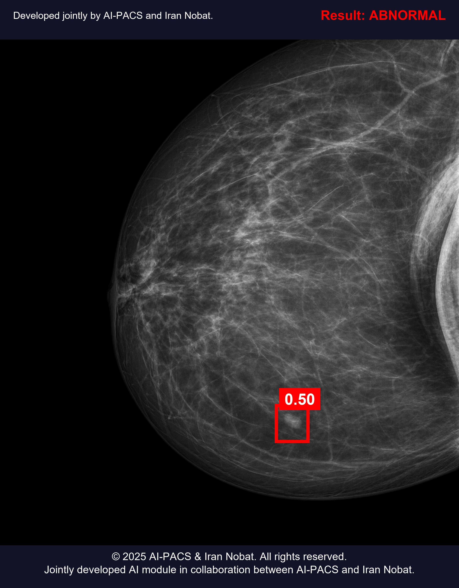
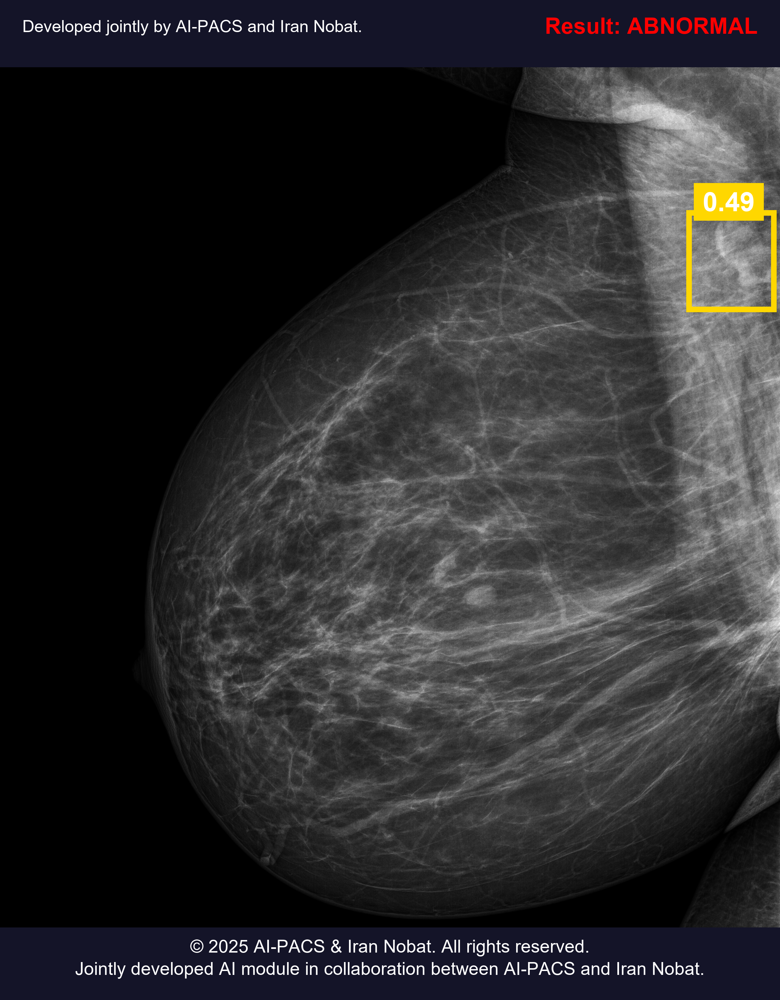
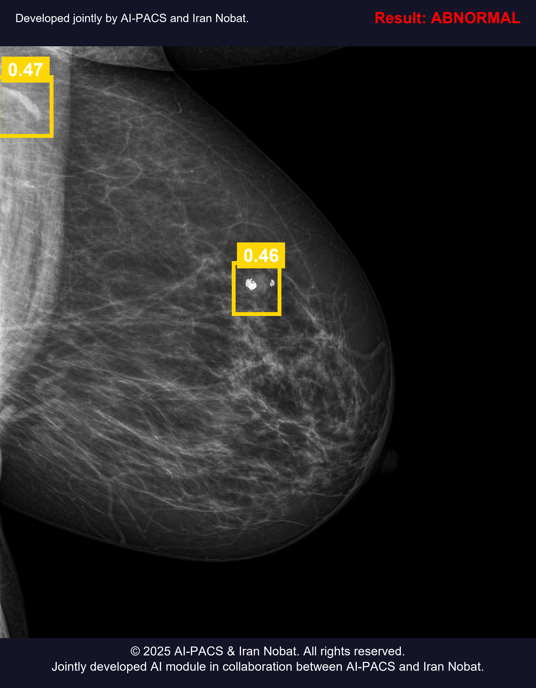
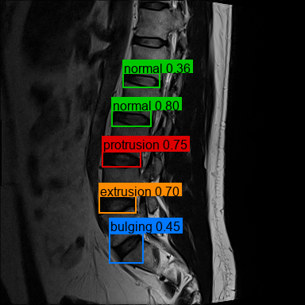
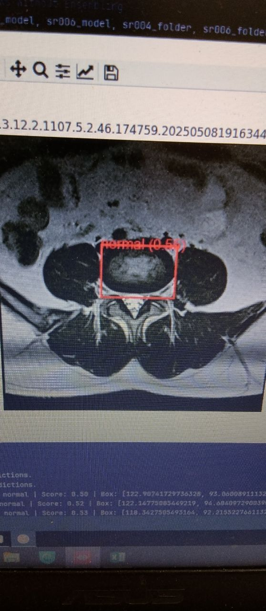
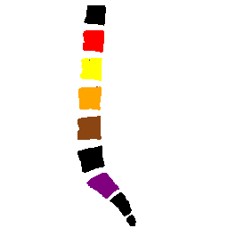

# Hi, I'm Aisan Rahimi 👋
### AI Engineer | Computer Vision Expert | Medical Imaging Specialist

🏢 Founder of [Apadana AI Research Center](https://github.com/Apadana-AI-Research-Center)  
📍 Tehran, Iran  
📧 a.rahimi141923@gmail.com  

---

## 🧠 About Me

AI Engineer and Computer Vision Expert with **5+ years of experience** in medical
imaging, petroleum data analysis, and AI software development. MSc in Photogrammetry
and Image Processing from K.N. Toosi University of Technology.

I build end-to-end AI pipelines for real-world clinical and industrial applications —
from research and model training to deployment and software integration.

---

## 🎯 Expertise

### 🏥 Medical AI

## 🏥 Featured Clinical AI Project | Intelligent Mammography Analysis & BI-RADS-Based Classification

**Clinical Collaboration:** Razi Radiology Center — Dr. Vahid Alizadeh  
**Joint Development:** AI-PACS & Iran Nobat | 2025  
**Research Status:** Ongoing Research — Publication in Preparation

### 🔬 Project Overview

Developed and clinically demonstrated an **AI-powered mammography analysis and clinical decision-support system** in collaboration with **Dr. Vahid Alizadeh at Razi Radiology Center**.

The project focuses on improving the detection of **subtle and potentially overlooked breast abnormalities**, including suspicious findings that may be challenging to recognize during routine mammographic interpretation.

The system provides:

- **Automated breast abnormality detection**
- **Localization of suspicious lesions**
- **BI-RADS-guided mammographic finding classification**
- **Visual identification of regions requiring further clinical attention**
- **Confidence-based AI predictions**
- **Integration with medical imaging workflows**

The objective is to support radiologists in identifying suspicious findings, improving screening efficiency, and providing an additional layer of AI-assisted image assessment.

### 🏥 Clinical Demonstration — Razi Radiology Center

The following images illustrate AI-assisted detection of potentially suspicious mammographic regions.

  
  

  
  

  <em>Examples of AI-assisted mammographic abnormality detection and candidate lesion localization.</em>

### 📊 Performance & Clinical Evaluation

The system demonstrated **promising detection and classification performance** during experimental evaluation.

**Selected Research Highlights:**

- **High abnormality detection accuracy:** Approximately 99% in the reported image-level evaluation.
- **High detection precision:** Approximately 98% positive predictive value in the reported test.
- **Strong sensitivity:** High sensitivity for identifying abnormal mammographic images.
- **BI-RADS-guided classification:** Classification of multiple mammographic finding types.
- **Subtle abnormality recognition:** Encouraging performance in identifying suspicious findings requiring closer examination.

The project demonstrates the potential of AI to assist radiologists with early identification of suspicious mammographic abnormalities.

**Note:** Reported results are research-stage evaluation findings and do not establish independently validated clinical diagnostic performance.

### 🖥️ Clinical Software Demonstration

The AI system was demonstrated within a medical imaging environment, providing automated abnormality predictions, visual localization, and interactive clinical image assessment.

  

  <em>Clinical software demonstration at Razi Radiology Center.</em>

### 🎯 Clinical Impact & Research Contribution

This project represents a significant application of **Artificial Intelligence in medical imaging**, combining practical clinical collaboration with advanced AI development.

Its primary contributions include:

- Supporting radiologists in reviewing challenging mammographic findings.
- Providing automated detection and visual localization of suspicious regions.
- Supporting standardized breast imaging assessment.
- Demonstrating AI integration into clinical imaging workflows.
- Exploring the potential of intelligent screening assistance in radiology.

The system is intended to **support radiologists rather than replace clinical judgment**. Further clinical validation is required before routine diagnostic use.

### 📄 Research & Publication

The technical methodology, experimental design, detailed evaluation results, and scientific contributions are currently being prepared for publication in a peer-reviewed journal.

**Detailed research information remains confidential pending publication.**

### 🛠️ Research Areas

**Medical Artificial Intelligence | Computer Vision | Mammography Analysis | Breast Lesion Detection | Medical Image Classification | Clinical Decision Support | Healthcare AI**

-Evaluation & Fine-Tuning of Vision-Language Models for Medical Image Understanding

Conducted experimental research on medical Vision-Language Models (VLMs) and Large Language Models (LLMs), focusing on multimodal medical image understanding, anatomical localization, disease interpretation, and automated radiology report generation. Evaluated and experimented with models including MedGemma, Gemma-based architectures, and PaliGemma-related object detection approaches, using brain imaging and chest CT datasets. Explored domain-specific fine-tuning strategies involving LoRA/PEFT, vision encoder adaptation, quantization, and image-text instruction tuning to improve medical image interpretation and structured clinical reporting. Investigated the ability of multimodal models to recognize abnormalities, identify anatomical regions, estimate spatial positions, and associate findings with their correct locations. Experiments revealed significant limitations in precise anatomical localization, spatial reasoning, and position-aware reporting, highlighting the challenges of applying general-purpose VLMs to detailed medical imaging tasks. This research provided hands-on experience in multimodal model evaluation, medical dataset preparation, fine-tuning, prompt engineering, and failure analysis, supporting the development of more reliable hybrid workflows combining specialized computer vision models with medical LLMs.

Technologies: Python | PyTorch | Hugging Face Transformers | MedGemma | PaliGemma | Vision-Language Models | LoRA/PEFT | Quantization | Medical Image Analysis | Multimodal Fine-Tuning

-Automated Lumbar Disc Disease Detection, Classification & AI-Assisted Radiology Reporting

Developed an end-to-end deep learning pipeline for automated lumbar spine MRI analysis, integrating intervertebral disc localization, segmentation, and pathology classification using Vision Transformers (ViT), object detection, and multi-task deep learning architectures. The system analyzes sagittal and axial MRI images to identify lumbar disc levels (L1–L2 through L5–S1) and classify disc conditions into four categories: Normal, Bulging, Protrusion, and Extrusion, providing confidence scores and visual bounding-box annotations. The project incorporated DICOM–NIfTI image-mask alignment, class-imbalance optimization, and multi-task segmentation and classification. Additionally, MedGemma integration was explored to transform structured imaging findings into AI-generated radiology-style reports, supporting automated medical image interpretation and clinical decision-support workflows.
Technologies: Python | PyTorch | Vision Transformers (ViT-B/16) | Object Detection | Medical Image Segmentation | DICOM | NIfTI | SimpleITK | MedGemma

<h4>Project Results — Lumbar Disc Disease Detection</h4>

  
  
  

  <em>AI-based lumbar disc detection and classification
  on sagittal and axial MRI images, with predicted
  pathology labels, bounding boxes, and confidence scores.</em>

-Automated Lumbar Vertebrae Segmentation & Classification Using Deep Learning

Developed an AI-powered lumbar spine MRI analysis system using a customized U-Net deep learning architecture for automated vertebral segmentation, identification, and anatomical classification. The model processes 2D sagittal MRI images and incorporates specialized strategies to address class imbalance and improve segmentation performance. An integrated classification head was designed to identify individual lumbar vertebrae and assign their corresponding anatomical levels (L1–L5). The system generates individual color-coded segmentation masks with anatomical labels, enabling automated vertebral localization and identification. This project demonstrates the application of Deep Learning, Medical Image Segmentation, Computer Vision, and Anatomical Structure Recognition to support quantitative spinal imaging analysis.

<h4>Automated Lumbar Spine MRI Analysis — Project Results</h4>

  
  

  <em>Original sagittal lumbar MRI (left) and
  AI-generated color-coded vertebral segmentation (right).</em>

Technologies: Deep Learning | Customized U-Net | Medical Image Processing | Semantic Segmentation | Multi-Class Classification | Lumbar Spine MRI
-AI-Assisted Goldmann Visual Field Analysis & Measurement Automation

Collaborated with an ophthalmology specialist on an AI-based medical image analysis project focused on Goldmann visual field perimetry. The project aimed to automate the interpretation and quantitative measurement of ophthalmic diagnostic charts using Computer Vision, Image Processing, and Artificial Intelligence. The proposed solution focused on identifying coordinate systems, detecting colored isopters and visual field boundaries, extracting geometric features, and supporting automated measurements of visual field extent and irregularities. The objective was to reduce time-consuming manual measurements, improve analytical consistency, and support ophthalmologists in clinical assessment through AI-assisted image analysis.

<h4>Goldmann Visual Field Analysis — Project Images</h4>

  
  

  <em>Original visual field chart (left) and
  AI-assisted analysis (right).</em>

- Mammography AI pipeline — BI-RADS classification, 85–98% precision
- Spine MRI segmentation — 85% Dice/IoU
- Bone age estimation from MRI — ~3 month mean error (ages 7–14)
- Ophthalmology AI — retinopathy detection & fundus analysis
- 3D medical depth estimation (Depth Anything V2, DPT)
- Vision-Language Model evaluation (MedGEMMA, CLIP, BLIP)

### 🛢️ Petroleum AI
- MFL pipeline defect detection (YOLO, UNet, FCOS)

- Well log conversion: LAS/DLIS → SEG-Y
- AI-assisted fracture & corrosion detection

### 👁️ Computer Vision
- Object detection & segmentation (YOLO v3/v5/v8, UNet, RetinaNet, FCOS)
- Medical image processing (ITK, VTK, SimpleITK, MONAI)
- Cross-platform AI software (C++/Qt, C#, Python)

---

## 🛠️ Tech Stack

**Frameworks:** PyTorch · TensorFlow · ONNX · Scikit-learn · XGBoost  
**Vision:** YOLO · UNet · RetinaNet · FCOS · EfficientNet · SAM  
**Medical:** ITK · VTK · MONAI · pydicom · SimpleITK  
**Software:** Qt/C++ · C# WPF · Python APIs · DICOM/PACS integration  

---

## 🏛️ My Company

**[Apadana AI Research Center](https://github.com/Apadana-AI-Research-Center)**  
Independent AI research & development — Medical Imaging | Petroleum AI | Computer Vision

---

## 📚 Education

🎓 **MSc** — Photogrammetry & Image Processing, K.N. Toosi University (KNTU), 2006  
🎓 **BSc** — Surveying Engineering, K.N. Toosi University (KNTU), 2002  

---

*Open to research collaboration and AI development partnerships.*
